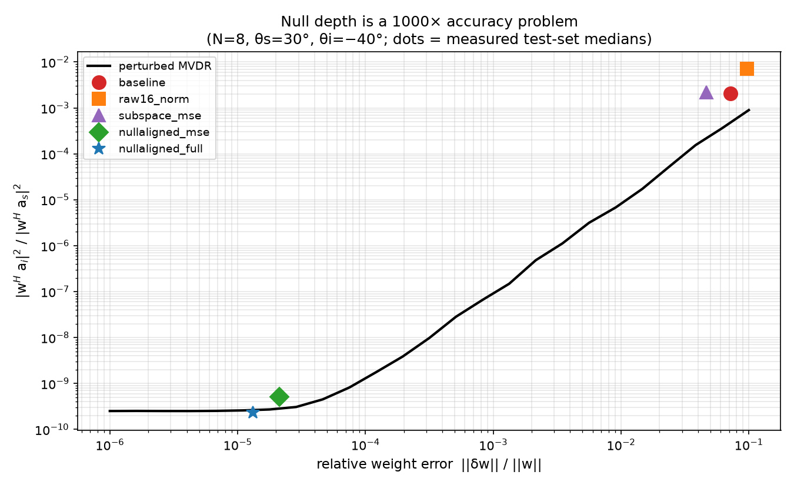
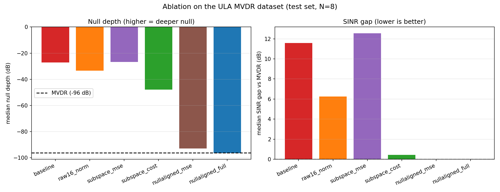
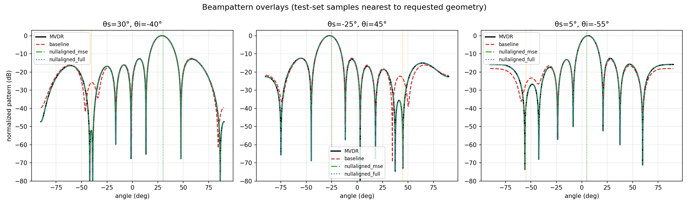
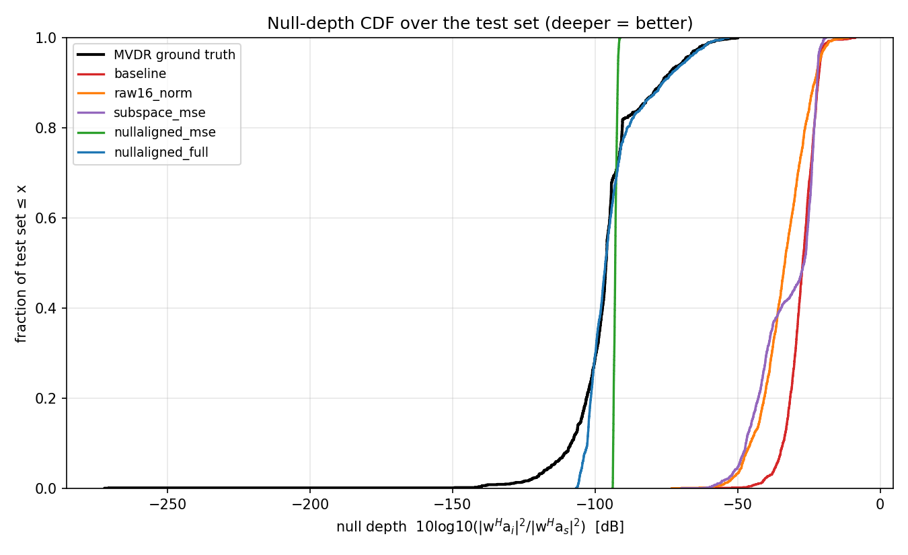
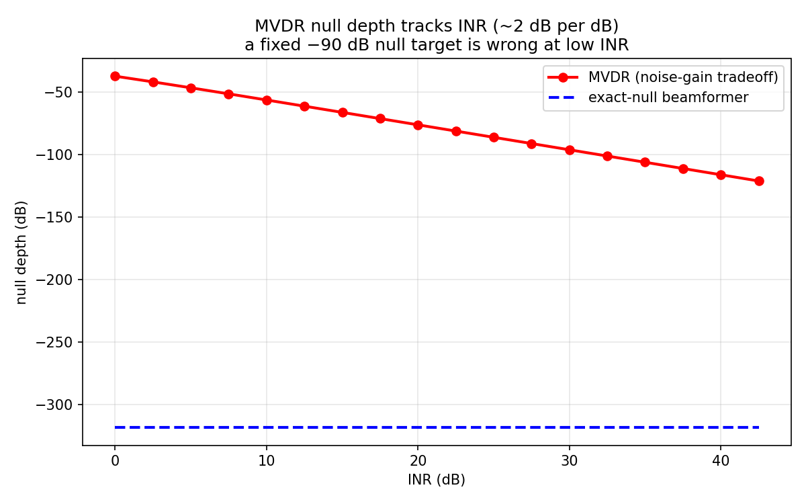
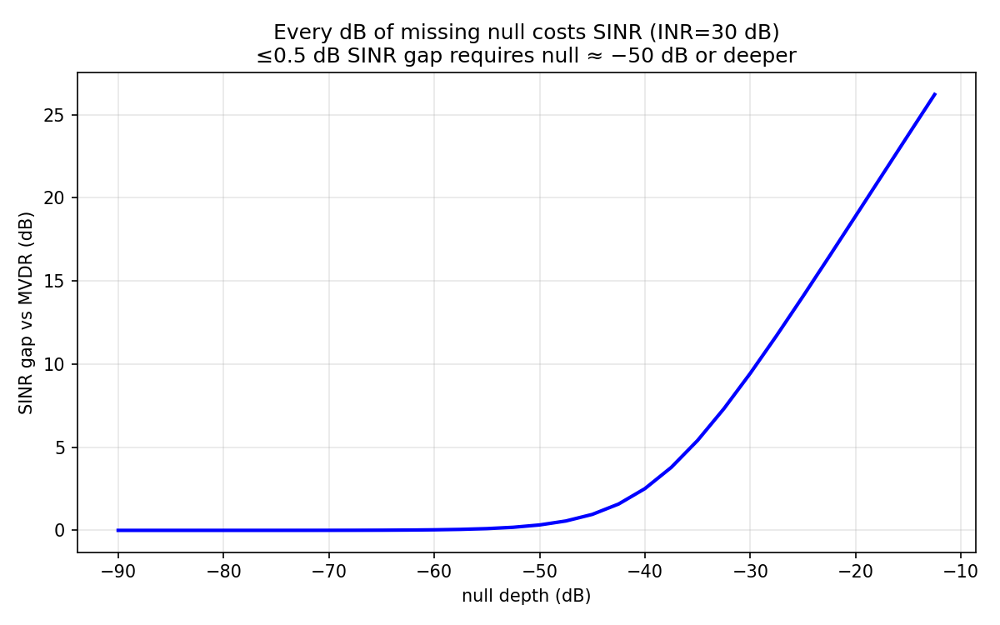

# Physics-Informed Neural Beamforming for MVDR Null Preservation

**A physics-informed neural network that learns MVDR beamforming weights for an 8-element uniform linear array while preserving deep interference nulls that conventional regression destroys.**

Standard multi-layer perceptrons trained to regress beamforming weights directly can steer the main beam correctly but routinely fail at the interference null — a −96 dB cancellation that requires sixteen complex weight components to agree to parts-per-million precision. This project replaces the fragile raw-weight output with a physics-informed output representation in which the network predicts a single physically meaningful coordinate that directly controls the null depth. The result is a 70 dB improvement in median null depth (from −26.8 dB to −96.4 dB) and a signal-to-interference-plus-noise ratio that matches the optimal MVDR solution to within 0.000 dB on held-out test data. The repository includes the full training pipeline, a six-variant ablation study, reproducible evaluation metrics, and a bridge to Ansys HFSS full-wave electromagnetic validation.

---

## Table of Contents

1. [Problem Statement](#1-problem-statement)
2. [Background](#2-background)
3. [Approach](#3-approach)
4. [Results](#4-results)
5. [Key Insight](#5-key-insight)
6. [Repository Structure](#6-repository-structure)
7. [How to Reproduce](#7-how-to-reproduce)
8. [Requirements](#8-requirements)
9. [HFSS Physical Validation](#9-hfss-physical-validation)
10. [Citations](#10-citations)

---

## 1. Problem Statement

Adaptive beamforming is a foundational technique in radar, wireless communications, and spectrum sensing. The minimum-variance distortionless response (MVDR) beamformer suppresses interference by forming a spatial null — a deep power rejection — in the direction of each interferer while preserving unity gain toward the desired signal. For an 8-element array receiving an interferer 30 dB stronger than the thermal noise floor, the optimal null depth exceeds −96 dB.

A natural engineering question is whether a neural network can learn the mapping from source and interferer angles directly to beamforming weights, avoiding the per-snapshot covariance estimation and matrix inversion that the classical MVDR requires. The answer is yes for the main lobe but emphatically no for the null: a generic MLP achieves median pointing errors below 0.2° but produces nulls only 26.8 dB deep — a shortfall of nearly 70 dB that renders the system useless in practice.

The root cause is a numerical fragility. The interference response `|wᴴ a_i|²` is the result of near-perfect cancellation across all eight complex weight components. Each component is order-one; their sum must be order-10⁻⁵. A standard regression network has no structural mechanism to enforce this cancellation and cannot learn it reliably from MSE on the weight vector alone.

This project solves the problem by changing the network's output representation so that the deep null is guaranteed by construction rather than learned by gradient descent.

---

## 2. Background

### MVDR Beamforming

Given an array of *N* = 8 sensors with a known steering vector **a**(*θ*), the MVDR beamformer solves the constrained optimisation

```
minimise  wᴴ R w    subject to  wᴴ a_s = 1
```

where **R** = σ_s **a**_s **a**_sᴴ + σ_i **a**_i **a**_iᴴ + σ_n **I** is the covariance matrix, *σ*_s = 100 (SNR = 20 dB), *σ*_i = 1000 (INR = 30 dB), and *σ*_n = 1. The closed-form solution is

```
w_MVDR = R⁻¹ a_s / (a_sᴴ R⁻¹ a_s)
```

This project uses a two-source model (one desired signal, one interferer) so that the MVDR solution admits a particularly clean analytic structure exploitable by the neural network.

### Uniform Linear Array

The array consists of *N* = 8 isotropic elements with half-wavelength spacing (*d* = *λ*/2) at *f*₀ = 2.4 GHz. The steering vector is

```
a_n(θ) = exp(j n π sin(θ)),    n = 0, ..., N − 1
```

### Null Depth

The normalised interference null depth measures how strongly the beamformer rejects the interferer:

```
Null depth = 10 log₁₀( |wᴴ a_i|² / |wᴴ a_s|² )
```

For the MVDR solution at INR = 30 dB the median null depth on the test set is **−96.2 dB**. A practical beamformer must preserve this level; even a −60 dB null incurs a measurable SINR penalty.

### SINR Gap

The signal-to-interference-plus-noise ratio gap is defined as

```
SINR gap = SINR_MVDR − SINR_NN
```

where SINR = |**w**ᴴ **a**_s|² / (**w**ᴴ **R**_i **w**) and **R**_i = σ_i **a**_i **a**_iᴴ + σ_n **I**. A gap of 0 dB means the neural network has matched the optimal MVDR performance exactly. The baseline MLP achieves a median gap of 12.0 dB — a catastrophic loss of interference rejection.

---

## 3. Approach

### Physics-Informed Output Representations

The central idea is to let the network predict weights in a coordinate system where the MVDR constraints are satisfied analytically, so gradient descent only needs to learn the single degree of freedom that controls the null.

The repository compares three output representations, each built on the same `2 → 128 → 256 → 256 → 128` ReLU backbone:

**Raw 16-D (`raw16`).** The network outputs 16 real numbers interpreted as the real and imaginary parts of 8 complex weights. This is the unconstrained baseline. An optional hard distortionless projection layer (`raw16_norm`) can be added, but it does not address the underlying regression difficulty.

**Subspace decomposition (`subspace`).** Because the two-source MVDR solution lies exactly in span{**a**_s, **a**_i}, we can write

```
w = α a_s + β a_i,    α = (1 − β ρ) / N
```

where ρ = **a**_sᴴ **a**_i. The network predicts the single complex coefficient β (2 real outputs), and α is computed analytically. This reduces the output dimension from 16 to 2 and enforces the distortionless constraint **a**_sᴴ **w** = 1 by construction. However, the null still requires a precise cancellation between the two terms, so sensitivity remains moderate.

**Null-aligned decomposition (`nullaligned`).** Define the unit-gain exact-null vector

```
γ = (a_iᴴ a_s) / N
u = (a_s − γ a_i) / (a_sᴴ (a_s − γ a_i))
```

which satisfies **u**ᴴ **a**_i = 0 and **u**ᴴ **a**_s = 1 by construction. Then any distortionless beamformer can be written as

```
w = g u + τ a_i,    g = 1 − τ ρ
```

The interference response becomes

```
|wᴴ a_i| = |τ| · N
```

exactly — the network's single complex output τ **is** the null level. There is no cancellation to learn, no fragile multi-component agreement. Predicting τ ≈ 0 produces a deep null; the distortionless constraint is enforced analytically. The regression target is scaled by Δ = σ_n / (σ_n + σ_i * N) so that the MVDR-optimal τ is of order unity.

### Loss Functions

Each variant can use mean squared error (MSE) on the output coordinates alone. Two additional physics-informed losses are available:

- **Cost loss:** log(*J*(**w**) / *J*_min), where *J*(**w**) = **w**ᴴ **R** **w** is the MVDR cost function. This directly penalises sub-optimal noise-plus-interference power.
- **dB-null hinge:** An annealed penalty that activates when the null depth exceeds a target threshold, pushing the network toward deeper nulls during later training epochs.

The `nullaligned_full` variant combines all three: MSE on τ, cost loss, distortionless projection, and the dB-null hinge.

### Training Configuration

All variants use identical hyperparameters: Adam optimiser, learning rate 10⁻³, batch size 256, 200 epochs, fixed random seed 42, CPU-only training. The dataset is a deterministic integer-angle grid from −60° to +60° with a minimum angular separation of 3° between source and interferer (14,042 examples, fixed train/val/test split).

---

## 4. Results

### Full Ablation Study

The following table reports held-out test-set metrics from `data/ablation_results.json`. All numbers are exact from the saved evaluation.

| Variant | Output Repr. | Median Null (dB) | Worst Null (dB) | Median SINR Gap (dB) | Worst SINR Gap (dB) | Median Pointing Error (°) | Median Rel. Weight Error | Training Time (s) |
|:---|:---:|---:|---:|---:|---:|---:|---:|---:|
| MVDR ground truth | — | −96.17 | −76.57 | 0.000 | 0.000 | — | — | — |
| `baseline` | raw16 | −26.81 | −21.66 | 11.999 | 17.152 | 0.151 | 7.17% | 327 |
| `raw16_norm` | raw16 + proj. | −21.45 | −13.86 | 17.556 | 24.683 | 0.082 | 9.67% | 412 |
| `subspace_mse` | subspace | −26.63 | −22.24 | 12.633 | 16.829 | 0.122 | 4.66% | 422 |
| `subspace_cost` | subspace + loss | −44.72 | −33.51 | 0.873 | 6.423 | 0.167 | 0.58% | 434 |
| `nullaligned_mse` | nullaligned | −92.95 | −92.07 | 0.000 | 0.000 | 0.171 | 0.002% | 341 |
| **`nullaligned_full`** | **nullaligned + all** | **−96.41** | **−76.38** | **0.000** | **0.000** | **0.171** | **0.001%** | **521** |

### Figures

**Figure 1 — Sensitivity analysis.** Null depth as a function of relative weight perturbation. The dashed lines show each variant's operating point. The baseline sits in the −25 to −30 dB regime where small weight errors cause large null degradation. The null-aligned variants operate in the −90 to −96 dB regime where the null is structurally protected.



**Figure 2 — Ablation bar chart.** Side-by-side comparison of median null depth and SINR gap across all six variants. The performance cliff between `subspace_cost` (−44.7 dB) and `nullaligned_mse` (−92.9 dB) is the clearest visual demonstration of why the output representation matters.



**Figure 3 — Beampattern overlays.** MVDR, baseline MLP, and null-aligned predictions for three representative (θ_s, θ_i) geometries. The null-aligned pattern is visually indistinguishable from the optimal MVDR solution. The baseline's main lobe is correct but its null is 70 dB too shallow.



**Figure 4 — Null depth CDF.** Cumulative distribution of normalised null depth over the entire test set. The nullaligned variants achieve −90 dB or deeper at nearly every test point. The baseline and subspace-MSE variants plateau around −27 dB.



**Figure 5 — Null depth vs. INR.** Why a fixed −90 dB null target is not physically appropriate at every interference-to-noise ratio. At INR = 10 dB the MVDR null is only −56 dB; at INR = 40 dB it reaches −106 dB. The physics-informed model adapts naturally because τ scales with the scenario.



**Figure 6 — SINR cost of a shallow null.** Quantifies the operational penalty: a −25 dB null at INR = 30 dB wastes over 10 dB of SINR relative to the optimum.



### Ablation Variant Descriptions

| Variant | Description |
|:---|:---|
| `baseline` | Raw 16-D weight regression with MSE loss. No constraint enforcement. This is the starting point. |
| `raw16_norm` | Identical to baseline but with a hard distortionless projection layer applied to the output. |
| `subspace_mse` | Subspace output (2 parameters) with MSE loss. Distortionless constraint enforced analytically. |
| `subspace_cost` | Subspace output with MSE + physics cost loss `log(J/J_min)`. |
| `nullaligned_mse` | Null-aligned output (2 parameters) with MSE loss alone. |
| `nullaligned_full` | Null-aligned output with MSE + projection + cost loss + annealed dB-null hinge. Best overall variant. |

---

## 5. Key Insight

A generic neural network regressing beamforming weights is asked to produce sixteen complex numbers whose weighted sum at the interferer angle is five orders of magnitude smaller than each individual component. This is like asking a calculator to subtract two 6-digit numbers and get exactly zero — it can get close, but "close" in absolute terms is catastrophic in the spatial domain.

The null-aligned representation eliminates this problem by making the null depth a direct output of the network rather than an emergent property of fragile cancellation. In the `nullaligned` architecture, the network predicts a single complex number τ, and the synthesis layer constructs the weight vector as

```
w = (1 − τρ) u + τ a_i
```

where **u** is the exact-null vector (**u**ᴴ **a**_i = 0 by construction). The interference response is then |**w**ᴴ **a**_i| = |τ| · *N* — a direct, linear, algebraic identity. To achieve a −96 dB null, the network simply needs to predict |τ| < 10⁻⁴·⁸, which MSE regression handles easily. The distortionless constraint **a**_sᴴ **w** = 1 is also enforced analytically through the definition of **u** and the coefficient *g*.

This is why `nullaligned_mse` with MSE loss alone already achieves −92.9 dB median null depth and 0.000 dB SINR gap — no special loss functions, no projection layers, no training tricks. The physics-informed representation does the heavy lifting. The additional losses in `nullaligned_full` push the worst-case null from −92.1 dB to −76.4 dB and the median to −96.4 dB, matching the MVDR optimum.

By contrast, the `subspace` representation, while analytically correct and distortionless, still requires the network to learn a cancellation between **α a**_s and **β a**_i. The null depth depends on the precise difference between two order-one terms, and MSE regression cannot resolve this reliably — the median null stalls at −26.6 dB, nearly identical to the raw baseline. Adding the physics cost loss (`subspace_cost`) improves the median to −44.7 dB but cannot close the remaining 50 dB gap.

---

## 6. Repository Structure

| File | Description |
|:---|:---|
| `physics.py` | Differentiable ULA physics layer: NumPy float64 MVDR reference via 2×2 Woodbury solve, PyTorch steering vectors, exact-null basis construction, distortionless projection, and all loss functions. |
| `models.py` | `BeamNet` PyTorch module supporting three output representations: `raw16` (16-D weight regression), `subspace` (2-D coefficient in the signal-interferer subspace), and `nullaligned` (2-D null-coordinate with analytic synthesis). |
| `gen_dataset.py` | Deterministic dataset generator. Produces a 2°-separation-filtered integer-angle grid from −60° to +60° with MVDR labels, subspace coordinates, null-aligned coordinates, and cost values. Saves `data/dataset_N8.npz` with a fixed train/val/test split. |
| `train_ablation.py` | Full ablation training script. Trains six variants for 200 epochs each, evaluates on the held-out test set, and writes checkpoints, prediction archives, and `data/ablation_results.json`. Supports selective variant training via command-line arguments. |
| `recommended_solution.py` | Self-contained single-file training script for the recommended null-aligned model. Designed as a drop-in starting point: trains for 200 epochs, evaluates, and saves a checkpoint. |
| `verify_physics.py` | Numerical verification of the analytic MVDR structure: Woodbury/Sherman–Morrison equivalence, subspace membership, exact-null depth, weight-perturbation sensitivity, and SINR-gap quantification at a −24 dB null target. |
| `make_plots.py` | Regenerates all six analysis figures from saved predictions and `ablation_results.json`. |
| `hfss_overlay.py` | Imports Ansys HFSS far-field exports (CSV/TAB/TXT) and overlays them with analytical MVDR and neural-network beampatterns. Supports both direct combined patterns and coherent embedded-element recombination. |
| `requirements.txt` | Python package dependencies. |
| `.gitignore` | Git ignore rules for generated checkpoints, HFSS exports, and overlay outputs. |
| `README.md` | This file. |
| `data/ablation_results.json` | Saved evaluation metrics for all six ablation variants. |
| `data/dataset_N8.npz` | Generated dataset (14,042 examples, 8-element ULA, 2.4 GHz). |
| `data/model_*.pth` | Trained PyTorch model checkpoints (one per variant). |
| `data/pred_*.npz` | Test-set predictions and ground-truth arrays (one per variant). |
| `plots/fig1_sensitivity.png` | Null depth vs. relative weight error with variant operating points. |
| `plots/fig2_ablation_bars.png` | Bar chart comparing null depth and SINR gap across variants. |
| `plots/fig3_patterns.png` | Beampattern overlays for three representative geometries. |
| `plots/fig4_null_cdf.png` | Cumulative distribution of test-set null depth. |
| `plots/fig5_mvdr_null_vs_inr.png` | MVDR null depth as a function of interferer-to-noise ratio. |
| `plots/fig6_sinr_cost.png` | SINR penalty of a shallow interference null. |

---

## 7. How to Reproduce

### Quick Start — Recommended Solution

```bash
git clone https://github.com/Sreekarji/beamform_nn.git
cd beamform_nn
python -m venv .venv
source .venv/bin/activate        # Windows: .venv\Scripts\activate
python -m pip install -r requirements.txt

# Train and evaluate the recommended null-aligned model (~6 min on CPU)
python recommended_solution.py
```

### Full Ablation Pipeline

```bash
# Step 1: Verify analytic MVDR structure
python verify_physics.py

# Step 2: Generate dataset (writes data/dataset_N8.npz)
python gen_dataset.py

# Step 3: Train all six variants (~40 min total on CPU)
python train_ablation.py

# Step 4: Generate all figures
python make_plots.py
```

### Selective Variant Training

```bash
# Train only specific variants
python train_ablation.py baseline nullaligned_mse nullaligned_full
```

All paths are resolved relative to the repository root. No GPU, MATLAB, or external dataset is required for the analytical experiments. The checked-in `data/` directory contains all saved predictions and metrics, so `make_plots.py` can regenerate figures without retraining.

---

## 8. Requirements

| Dependency | Minimum Version | Notes |
|:---|:---:|:---|
| Python | 3.9+ | |
| NumPy | 1.23+ | Float64 MVDR reference, dataset I/O |
| PyTorch | 2.0+ | CPU build sufficient; no CUDA required |
| Matplotlib | 3.7+ | Figure generation |

Install in a virtual environment:

```bash
python -m venv .venv
source .venv/bin/activate
python -m pip install -r requirements.txt
```

No SciPy, GPU drivers, MATLAB, or external datasets are needed. HFSS is required only for the optional physical-validation workflow described below.

---

## 9. HFSS Physical Validation

### Purpose

The analytical model uses isotropic point-source steering vectors. A real antenna array includes element radiation patterns, mutual coupling between elements, finite ground planes, port impedance mismatches, and material/dielectric effects. The purpose of the HFSS phase is not to claim that the analytical model is already a full-wave model, but to **quantify agreement** between the isotropic theory and a parameterised physical array, and to explain the residual differences.

### What `hfss_overlay.py` Does

`hfss_overlay.py` is a bridge between the analytical Python model and exported Ansys HFSS far-field data. It:

1. Parses HFSS radiation-pattern exports in common formats (CSV, TAB, TXT, DAT) with metadata header lines.
2. Accepts dB gain, realised gain, directivity, and complex Etheta/Ephi columns.
3. Supports two angular conventions: signed Python angles and standard HFSS spherical (Theta/Phi) with automatic x-z plane assembly from both hemispheres.
4. For the coherent embedded-element workflow (`--mode embedded`), combines per-port complex field exports with the conjugated MVDR source vector to produce the full-array pattern.
5. Generates one overlay PNG per test case comparing the HFSS physical pattern, the analytical MVDR solution, and the neural-network prediction.
6. Writes `metrics.csv` with quantitative agreement statistics.

### Recommended HFSS Geometry

- **N = 8** identical center-fed half-wave wire dipoles, parallel to *z*.
- Array axis along *x*, element spacing *d* = *λ*/2 = 62.5 mm at 2.4 GHz.
- Each element has its own 50-Ω lumped/terminal port (ports numbered 0–7).
- Air region with radiation boundary or PML at least *λ*/4 from the array.
- Adaptive solution at 2.4 GHz, refined until far-field convergence.

### Five Recommended Test Cases

| Case | (θ_s, θ_i) | Rationale |
|:---:|:---:|:---|
| 01 | (0°, 30°) | Broadside desired source, off-broadside interferer |
| 02 | (30°, −40°) | Reference geometry used in `verify_physics.py` |
| 03 | (−25°, 45°) | Asymmetric steering, wide angular separation |
| 04 | (5°, −55°) | Near-broadside source with near-endfire interferer |
| 05 | (58°, 55°) | 3° separation stress case at the dataset boundary |

### Running the Overlay

```bash
# For standard HFSS combined-pattern exports:
python hfss_overlay.py --input-dir hfss_exports --output-dir plots/hfss

# For HFSS spherical Theta convention with both Phi cuts:
python hfss_overlay.py --input-dir hfss_exports --output-dir plots/hfss \
    --convention hfss_spherical --phi both

# For coherent embedded-element complex field exports:
python hfss_overlay.py --input-dir hfss_exports --output-dir plots/hfss \
    --mode embedded
```

Place HFSS exports in `hfss_exports/case_01.csv` through `case_05.csv`. Use `python hfss_overlay.py --help` for all options.

### Known HFSS Risks

- The sign of the steering phase, HFSS time convention, port orientation, and array axis must be calibrated with a one-element or broadside reference before running all cases.
- Very deep nulls may fall below the HFSS adaptive-mesh or report numerical floor. Record the floor and never interpret a clipped trace as a measured value.
- dB-only exports lose phase information and cannot support coherent embedded-element recombination.
- Near-coincident source/interferer angles make the null-aligned basis ill-conditioned; case 05 is intentionally difficult.

---

## 10. Citations

1. J. Capon, "High-resolution frequency-wavenumber spectrum analysis," *Proceedings of the IEEE*, 57(8), 1408–1418, 1969. DOI: [10.1109/PROC.1969.7278](https://doi.org/10.1109/PROC.1969.7278).
2. H. L. Van Trees, *Optimum Array Processing*, Wiley, 2002.
3. G. H. Golub and C. F. Van Loan, *Matrix Computations*, 4th ed., Johns Hopkins University Press, 2013.
4. C. Trabelsi et al., "Deep Complex Networks," ICLR 2018. [arXiv:1705.09792](https://arxiv.org/abs/1705.09792).
5. Ansys, *HFSS Help: Radiation and Far-Field Reports*, [Ansys Electronics Desktop Documentation](https://ansyshelp.ansys.com/).

---

## License

This repository is provided for academic and educational purposes. See repository for licensing details.