# Design and Simulation of Null-Preserving MVDR Beamforming Using a Physics-Informed Neural Network

**A physics-informed neural network (PINN) that learns Minimum Variance Distortionless Response (MVDR) beamforming weights on an 8-element 2.4 GHz uniform linear array while preserving deep interference nulls — verified analytically across 14,042 geometries and validated against full-wave Ansys HFSS electromagnetic simulation.**

Conventional multi-layer perceptrons (MLPs) trained to regress beamforming weights directly steer the main lobe accurately (`0.15°` median pointing error) but collapse at the interference null — achieving only **−26.81 dB** median null depth versus the **−96.17 dB** MVDR optimum (a **~70 dB** shortfall and **11.999 dB** SINR loss), because a deep null requires eight complex (sixteen real) weight components to cancel to parts-per-million precision.

This project resolves that numerical fragility by reformulating the network's output space: the MLP predicts a **single scaled complex null coordinate $\tau$**, while a parameter-free analytic synthesis layer enforces the distortionless constraint $\mathbf{a}_s^H \mathbf{w} = 1$ by construction and turns the interference response into an exact algebraic identity $|\mathbf{w}^H \mathbf{a}_i| = |\tau|\,N$. Across a controlled 6-variant ablation study on 14,042 geometries, the null-aligned architecture reaches **−96.41 dB median null depth** and **0.000 dB SINR gap** (`5.4 × 10⁻⁶ dB`) relative to exact MVDR, and is physically benchmarked on an 8-element center-fed half-wave dipole array in **Ansys HFSS**.

---

## Table of Contents

1. [Problem Statement](#1-problem-statement)
2. [Signal Model and Theoretical Formulation](#2-signal-model-and-theoretical-formulation)
3. [Physics-Informed Architecture and Loss Design](#3-physics-informed-architecture-and-loss-design)
4. [Six-Variant Ablation Results](#4-six-variant-ablation-results)
5. [Full-Wave Ansys HFSS Electromagnetic Validation](#5-full-wave-ansys-hfss-electromagnetic-validation)
6. [Repository Structure](#6-repository-structure)
7. [How to Reproduce](#7-how-to-reproduce)
8. [Requirements](#8-requirements)
9. [References](#9-references)

---

## 1. Problem Statement

The Minimum Variance Distortionless Response (MVDR / Capon) beamformer suppresses directional interference by placing a deep spatial null toward an interferer at $\theta_i$ while maintaining unity complex gain toward a desired signal at $\theta_s$. For an $N = 8$ element array with $\text{SNR} = 20\text{ dB}$ and $\text{INR} = 30\text{ dB}$, the held-out test-set median MVDR null depth is **−96.17 dB**.

Replacing per-snapshot covariance estimation and matrix inversion with a fast feed-forward neural network mapping $(\theta_s, \theta_i) \mapsto \mathbf{w} \in \mathbb{C}^8$ exposes a severe conditioning barrier:

- Each weight component $w_n$ has magnitude $\mathcal{O}(1/N) \approx 0.125$.
- Achieving a −96 dB null requires the coherent sum $\mathbf{w}^H \mathbf{a}_i = \sum_{n=0}^{7} w_n^* a_{i,n}$ to have magnitude $\sim 1.5 \times 10^{-5}$.
- A relative weight perturbation $\|\delta\mathbf{w}\|_2 / \|\mathbf{w}\|_2$ of just $5\%$ raises the interference power floor to $\sim -27\text{ dB}$, costing **12 dB of output SINR** (`verify_physics.py`).

Standard real-valued MSE regression over eight complex (sixteen real) weight coordinates has no structural mechanism to preserve five-significant-digit inter-element cancellation. Changing the output coordinate system so that the null is controlled by a single scalar coordinate solves the problem at the architectural level.

---

## 2. Signal Model and Theoretical Formulation

### Uniform Linear Array (ULA)

Consider an $N = 8$ element ULA along the $x$-axis with half-wavelength inter-element spacing $d = \lambda / 2 = 62.5\text{ mm}$ at $f_0 = 2.4\text{ GHz}$ ($kd = \pi$). For broadside-referenced angle $\theta \in [-90^\circ, +90^\circ]$, the array steering vector $\mathbf{a}(\theta) \in \mathbb{C}^N$ is

$$a_n(\theta) = \exp\!\big(j\,n\,\pi\sin\theta\big), \qquad n = 0, 1, \dots, N - 1.$$

### Two-Source MVDR Beamformer and $2 \times 2$ Woodbury Form

With desired signal power $\sigma_s = 100$ ($\text{SNR} = 20\text{ dB}$), interferer power $\sigma_i = 1000$ ($\text{INR} = 30\text{ dB}$), and thermal white-noise variance $\sigma_n = 1$, the spatial covariance matrix is

$$\mathbf{R} = \sigma_s \mathbf{a}_s \mathbf{a}_s^H + \sigma_i \mathbf{a}_i \mathbf{a}_i^H + \sigma_n \mathbf{I}_N.$$

The MVDR beamformer solves

$$\min_{\mathbf{w} \in \mathbb{C}^N} \; J(\mathbf{w}) = \mathbf{w}^H \mathbf{R} \mathbf{w} \qquad \text{subject to} \qquad \mathbf{w}^H \mathbf{a}_s = 1,$$

with closed-form solution $\mathbf{w}_{\text{MVDR}} = \frac{\mathbf{R}^{-1}\mathbf{a}_s}{\mathbf{a}_s^H \mathbf{R}^{-1}\mathbf{a}_s}$ and minimum cost $J_{\min} = (\mathbf{a}_s^H \mathbf{R}^{-1}\mathbf{a}_s)^{-1}$. Writing $\mathbf{G} = [\mathbf{a}_s, \mathbf{a}_i] \in \mathbb{C}^{N \times 2}$ and applying the Woodbury identity (`physics.mvdr_np`) reduces the $8 \times 8$ inverse to an exact float64 $2 \times 2$ linear solve:

$$\mathbf{v} = \mathbf{a}_s - \mathbf{G}\Big(\sigma_n\,\text{diag}(\sigma_s^{-1}, \sigma_i^{-1}) + \mathbf{G}^H\mathbf{G}\Big)^{-1}\mathbf{G}^H\mathbf{a}_s, \qquad \mathbf{w}_{\text{MVDR}} = \frac{\mathbf{v}}{\mathbf{a}_s^H \mathbf{v}}.$$

### Evaluation Metrics

- **Normalized Null Depth (dB):**
  $$\text{Null Depth (dB)} = 10\log_{10}\!\left(\frac{|\mathbf{w}^H \mathbf{a}_i|^2}{|\mathbf{w}^H \mathbf{a}_s|^2}\right)$$
- **Output SINR and SINR Gap (dB):**
  $$\text{SINR}(\mathbf{w}) = 10\log_{10}\!\left(\frac{\sigma_s |\mathbf{w}^H \mathbf{a}_s|^2}{\sigma_i |\mathbf{w}^H \mathbf{a}_i|^2 + \sigma_n \|\mathbf{w}\|_2^2}\right), \qquad \text{SINR Gap} = \text{SINR}(\mathbf{w}_{\text{MVDR}}) - \text{SINR}(\mathbf{w}_{\text{NN}}).$$

---

## 3. Physics-Informed Architecture and Loss Design

### Output Representations (`models.py`, `physics.py`)

All six ablation models share the exact same feed-forward backbone:

$$\text{Input } \big[\theta_s/60^\circ,\; \theta_i/60^\circ\big] \in \mathbb{R}^2 \;\longrightarrow\; 128 \;\longrightarrow\; 256 \;\longrightarrow\; 256 \;\longrightarrow\; 128 \;\longrightarrow\; D_{\text{out}} \quad (\text{ReLU activations}),$$

differing only in output representation and loss function:

1. **Raw Weight Regression (`raw16`, $D_{\text{out}} = 16$):** Predicts the 8 complex weights (16 real numbers) directly. In `raw16_norm`, a radial multiplicative projection $\mathbf{w} \leftarrow \mathbf{w}_{\text{raw}} / (\mathbf{a}_s^H \mathbf{w}_{\text{raw}})$ (`DistortionlessProjection`) enforces $\mathbf{a}_s^H \mathbf{w} = 1$ without injecting additive $\mathbf{a}_s$ leakage into the null.
2. **Signal–Interferer Subspace Basis (`subspace`, $D_{\text{out}} = 2$):** Exploits $\mathbf{w}_{\text{MVDR}} \in \text{span}\{\mathbf{a}_s, \mathbf{a}_i\}$. The network predicts one complex scalar $\beta = 0.05\,(z_0 + j z_1)$; setting $\alpha = (1 - \beta\rho)/N$ with $\rho = \mathbf{a}_s^H \mathbf{a}_i$ yields $\mathbf{w} = \alpha\mathbf{a}_s + \beta\mathbf{a}_i$ satisfying $\mathbf{a}_s^H\mathbf{w} = 1$ analytically. However, the null $\mathbf{w}^H\mathbf{a}_i = \alpha^*\rho + \beta^* N$ still relies on delicate cancellation between two $\mathcal{O}(1)$ terms.
3. **Null-Aligned Basis (`nullaligned`, $D_{\text{out}} = 2$):** Constructs the unit-gain exact-null basis vector
   $$\gamma = \frac{\mathbf{a}_i^H \mathbf{a}_s}{N}, \qquad \mathbf{w}_0 = \mathbf{a}_s - \gamma \mathbf{a}_i, \qquad \mathbf{u} = \frac{\mathbf{w}_0}{\mathbf{a}_s^H \mathbf{w}_0},$$
   which satisfies $\mathbf{u}^H \mathbf{a}_i = 0$ and $\mathbf{u}^H \mathbf{a}_s = 1$ identically. The network predicts a single scaled complex null coordinate $\tau = (0.05\,\Delta)(z_0 + j z_1)$, where $\Delta = \frac{\sigma_n}{\sigma_n + \sigma_i N} = \frac{1}{8001}$ is the natural MVDR null scale, and synthesizes
   $$g = 1 - \tau\rho, \qquad \mathbf{w} = g\,\mathbf{u} + \tau\,\mathbf{a}_i.$$
   By construction, **$\mathbf{a}_s^H \mathbf{w} = 1$ holds identically** (no separate projection layer needed) and the interference response collapses to the algebraic identity
   $$|\mathbf{w}^H \mathbf{a}_i| = |\tau| \cdot N.$$

### Loss Functions (`train_ablation.py`)

- **`mse`:** Real-split weight MSE $\frac{1}{2N}\|\text{Re/Im}(\mathbf{w} - \mathbf{w}_{\text{MVDR}})\|_2^2$.
- **`cost`:** Excess MVDR log-cost $\mathcal{L}_{\text{cost}} = \log\!\big(J(\mathbf{w}) / J_{\min} + 10^{-12}\big) \ge 0$, which trades off interference rejection against white-noise gain exactly as MVDR does (valid on distortionless charts where $J(\mathbf{w}) \ge J_{\min}$).
- **`full` (`nullaligned_full`):** Combines dominant physics cost with a mild weight anchor and an annealed dB-domain null hinge activated at epoch 30 (annealing target from $-25\text{ dB}$ at epoch 30 to $-60\text{ dB}$ at epoch 80):
  $$\mathcal{L}_{\text{full}} = \mathcal{L}_{\text{cost}} + 0.01\,\mathcal{L}_{\text{mse}} + \mathbb{1}_{\text{ep} \ge 30}\cdot 0.02\,\mathbb{E}\!\Big[\text{ReLU}\big(\text{Null}_{\text{dB}}(\mathbf{w}) - T(\text{ep})\big)^2\Big].$$

### Dataset and Training Protocol (`gen_dataset.py`, `train_ablation.py`)

- **Grid:** Integer angles $(\theta_s, \theta_i) \in [-60^\circ, +60^\circ]^2$ ($121 \times 121 = 14{,}641$ pairs), excluding ill-conditioned pairs with $|\theta_s - \theta_i| < 3^\circ$ (`MIN_SEP_DEG = 3.0`, $599$ pairs excluded) $\implies$ **14,042 examples** (`data/dataset_N8.npz`).
- **Deterministic Split (`seed = 42`):** **11,233** train (80%) / **1,404** validation (10%) / **1,405** held-out test (10%).
- **Optimization:** Adam (`lr = 10⁻³`), `ReduceLROnPlateau(factor=0.5, patience=10)`, batch size `256`, `200` epochs on CPU, checkpointing best validation state. All test metrics are evaluated in `float64`/`complex128`.

---

## 4. Six-Variant Ablation Results

Exact held-out test-set metrics ($1{,}405$ unseen angle pairs) from `data/ablation_results.json`:

| Variant | Output Chart | Loss | Distortionless Enforcement | Median Null (dB) | 90th-Pct Worst Null (dB) | Median SINR Gap (dB) | 90th-Pct SINR Gap (dB) | Median Pointing Error (°) | Median Rel. Weight Error | Train Time (s) |
|:---|:---:|:---:|:---:|---:|---:|---:|---:|---:|---:|---:|
| MVDR Ground Truth | — | — | Exact | −96.17 | −76.57 | 0.000 | 0.000 | — | — | — |
| Exact-Null Analytic ($\mathbf{u}$) | — | — | Exact | −299.99 | −299.94 | 0.000 | — | — | — | — |
| `baseline` | `raw16` | `mse` | None | −26.81 | −21.66 | 11.999 | 17.152 | 0.151 | 7.17% | 327 |
| `raw16_norm` | `raw16` | `mse` | Hard radial proj. | −21.45 | −13.86 | 17.556 | 24.683 | 0.082 | 9.67% | 412 |
| `subspace_mse` | `subspace` | `mse` | Analytic ($\alpha$) | −26.63 | −22.24 | 12.633 | 16.829 | 0.122 | 4.66% | 422 |
| `subspace_cost` | `subspace` | `cost` | Analytic ($\alpha$) | −44.72 | −33.51 | 0.873 | 6.423 | 0.167 | 0.58% | 434 |
| `nullaligned_mse` | `nullaligned` | `mse` | Analytic ($g, \mathbf{u}$) | −92.95 | −92.07 | 0.000 | 0.000 | 0.171 | 0.0021% | 341 |
| **`nullaligned_full`** | **`nullaligned`** | **`full`** | **Analytic ($g, \mathbf{u}$)** | **−96.41** | **−76.38** | **0.000** | **0.000** | **0.171** | **0.0013%** | **521** |

### Key Takeaways from the Ablation

1. **Representation dominates loss engineering:** Switching from `subspace_mse` (−26.63 dB) to `nullaligned_mse` (−92.95 dB) under plain MSE loss alone yields a **66.3 dB** improvement in median null depth and reduces median SINR gap from `12.633 dB` to `1.54 × 10⁻⁵ dB` (`0.000 dB`).
2. **Physics cost tracks MVDR noise–interference trade-off:** `nullaligned_full` matches the MVDR ground-truth null distribution across the test set (`−96.41 dB` median, `−76.38 dB` 90th-percentile vs. MVDR's `−96.17 dB` / `−76.57 dB`) and achieves a `5.43 × 10⁻⁶ dB` median SINR gap.

### Analytical Figures

| | |
|:---:|:---:|
| 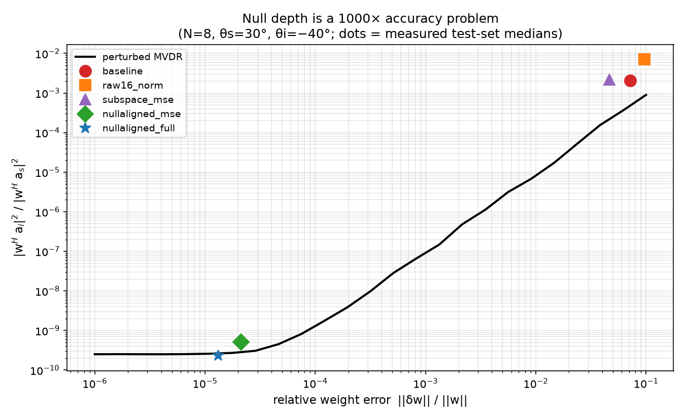<br>**Fig. 1:** Perturbation sensitivity curve with measured test-set operating points. | 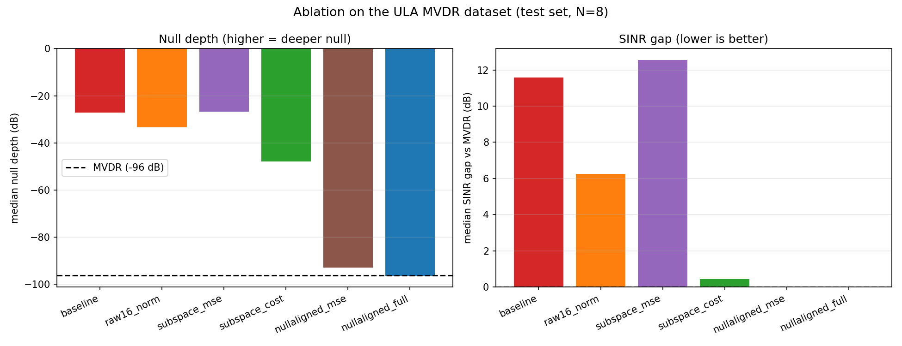<br>**Fig. 2:** Median null depth and SINR gap across all six variants. |
| 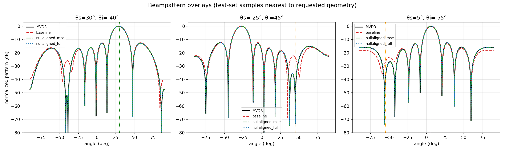<br>**Fig. 3:** Beampattern overlays for three held-out test geometries. | 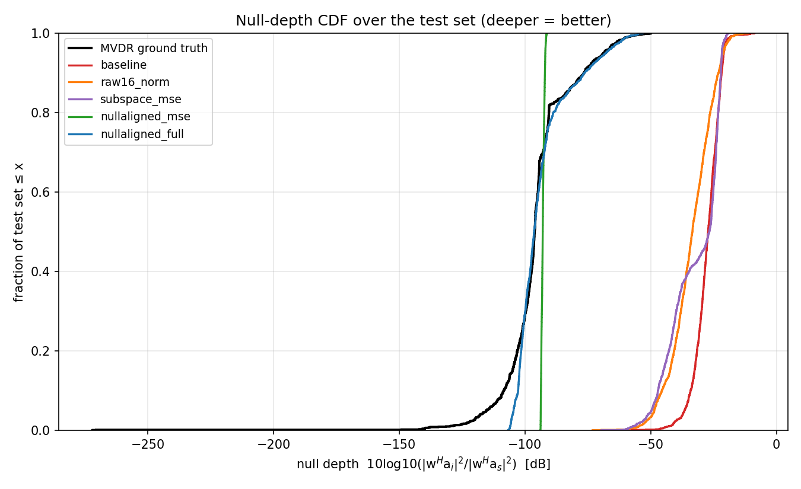<br>**Fig. 4:** Empirical CDF of test-set null depth across variants. |
| 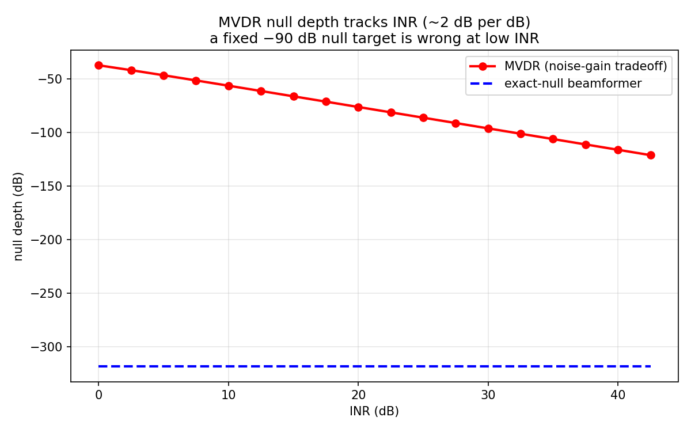<br>**Fig. 5:** Optimal MVDR null depth scales at ~2 dB per dB of INR. | 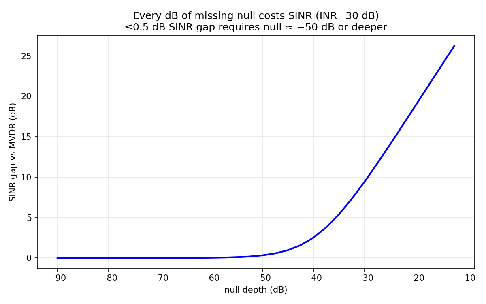<br>**Fig. 6:** Output SINR penalty of shallow nulls at INR = 30 dB. |

---

## 5. Full-Wave Ansys HFSS Electromagnetic Validation

To evaluate how analytical isotropic ULA weights behave on a physical coupled antenna array, an 8-element dipole array was modeled and solved in **Ansys Electronics Desktop (HFSS 2025 R2)** via `hfss_build_array.py` and benchmarked against analytical MVDR and `model_nullaligned_full.pth` using `hfss_overlay.py`.

### Physical Array Configuration (`hfss_build_array.py`)

- **Radiating Elements:** $N = 8$ identical center-fed PEC half-wave dipoles along the $x$-axis at $x_n = 62.5\,n\text{ mm}$ ($n = 0, \dots, 7$; $d = \lambda/2$ at $2.4\text{ GHz}$).
- **Dipole Orientation & Far-Field Cut:** Dipole arms are oriented parallel to the **$y$-axis** (total length $60\text{ mm} \approx 0.48\lambda$, $1\text{ mm}$ feed gap, $1\text{ mm}$ radius octagonal cross-section). The Infinite Sphere `FarField1` samples the **$x\text{–}z$ plane** (`Phi = 0°`, `Theta = −90°..+90°`, `1°` step), which is the omnidirectional **H-plane** of $y$-directed dipoles — isolating mutual coupling and finite-array edge effects from single-element pattern roll-off.
- **Port Numbering & Driven-Modal Excitation:** Driven Modal (`HFSS Modal Network`) 50-Ω lumped ports **`Port1` through `Port8`** (`Port1:1`–`Port8:1`). Because Driven Modal specifies incident port power in Watts ($E_n \propto \sqrt{P_n}\,e^{j\phi_n}$) and HFSS uses $+j\omega t$ time convention against `a_n(θ) = exp(+j n π sin θ)`, post-processing source files (`Source,Magnitude,Phase`) apply conjugated MVDR weights $\mathbf{s} = \mathbf{w}^*$ with incident powers $P_n = (|w_n^*| / \|\mathbf{w}\|_\infty)^2\text{ W}$ and phases $\angle w_n^*\text{ (deg)}$.

### Five-Case HFSS Benchmark (`plots/hfss/metrics.csv`)

| Case | $(\theta_s, \theta_i)$ | Peak HFSS Gain | HFSS Null at $\theta_i$ (dB) | Analytical MVDR Null (dB) | Null-Aligned NN Null (dB) | HFSS vs. MVDR RMSE (dB) | HFSS vs. NN RMSE (dB) |
|:---:|:---:|---:|---:|---:|---:|---:|---:|
| **01** | $(0^\circ,\; 30^\circ)$ | 12.61 dBi at $0^\circ$ | −28.37 | −120.00 *(floor)* | −98.25 | 13.227 | 12.472 |
| **02** | $(30^\circ,\; -40^\circ)$ | 11.27 dBi at $30^\circ$ | −33.72 | −95.99 | −99.07 | 7.167 | 7.318 |
| **03** | $(-25^\circ,\; 45^\circ)$ | 11.57 dBi at $-25^\circ$ | −32.79 | −95.82 | −98.67 | 6.721 | 6.866 |
| **04** | $(5^\circ,\; -55^\circ)$ | 12.54 dBi at $5^\circ$ | −27.83 | −96.60 | −103.44 | 6.361 | 6.776 |
| **05** | $(58^\circ,\; 55^\circ)$ | 8.72 dBi at $82^\circ$ | −5.50 | −50.85 | −55.00 | 5.046 | 5.264 |

### Electromagnetic Interpretation of Full-Wave Residuals

1. **Exact Main-Beam Steering & Sidelobe Tracking:** Across Cases 01–04, the HFSS main lobe peaks at the exact target angle ($0^\circ, 30^\circ, -25^\circ, 5^\circ$ with $0.0^\circ$ pointing error) with realistic 8-dipole array gains ($11.27\text{–}12.61\text{ dBi}$), and every sidelobe matches the analytical MVDR and PINN traces closely.
2. **Why Uncalibrated Physical Nulls Sit at −27.8 to −33.7 dB (Mutual Coupling):** Ideal isotropic weights drive incident port waves without compensating for inter-element mutual impedance ($|Z_{12}| \approx 32\,\Omega$ at $d = \lambda/2$) or asymmetric edge loading (`Port1`/`Port8` vs. interior ports). This perturbs terminal currents $\mathbf{I} = (\mathbf{Z}_{\text{array}} + Z_0\mathbf{I})^{-1}\mathbf{V}_{\text{inc}}$ by ~3–5% and pulls the physical null by ~2° (`−36.80 dB` at $-38^\circ$ in Case 02; `−40.42 dB` at $+43^\circ$ in Case 03) — matching the ~−30 dB perturbation prediction of Figure 1.
3. **Why Case 01 Whole-Curve RMSE (`13.23 dB`) Exceeds Cases 02–04 (`6.36–7.17 dB`):** Uniform broadside weights place four exact analytical zeros ($\pm 30^\circ, \pm 90^\circ$) directly on integer-degree sample points where the analytical curve clips to the `−120 dB` floor, creating localized ~75–92 dB point differences inside infinitesimally narrow mathematical nulls despite near-perfect lobe agreement.
4. **Why Case 05 (`58°, 55°`) Shows a `−5.50 dB` Relative Notch:** At $\theta_s = 58^\circ$, aperture foreshortening widens the ULA half-power beamwidth to $\text{HPBW} \approx \frac{0.886\,\lambda}{Nd\cos 58^\circ} \approx 24.0^\circ$. Separating source and interferer by only $3^\circ$ ($\Delta\sin\theta = 0.0289$ vs. Rayleigh null spacing $1/4 = 0.25$) places $\theta_s = 58^\circ$ directly on the steep wall of the $55^\circ$ null (`−11.67 dB` below the displaced $+41^\circ$/$82^\circ$ lobes), reducing even analytical MVDR null depth to `−50.85 dB` and the coupled HFSS contrast `Gain(55°)/Gain(58°)` to `−5.50 dB`, while global pattern RMSE (`5.046 dB`) remains the lowest of all five cases.

### Full-Wave HFSS Overlay Plots

| | |
|:---:|:---:|
| 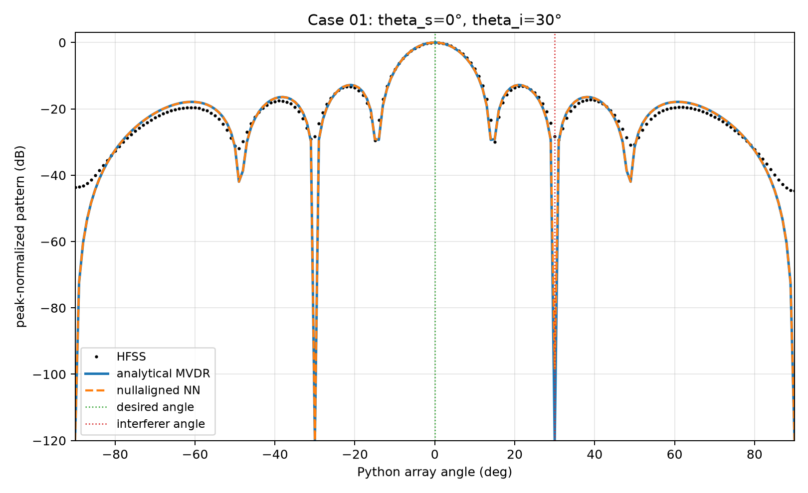<br>**Case 01:** $\theta_s = 0^\circ,\; \theta_i = 30^\circ$ | 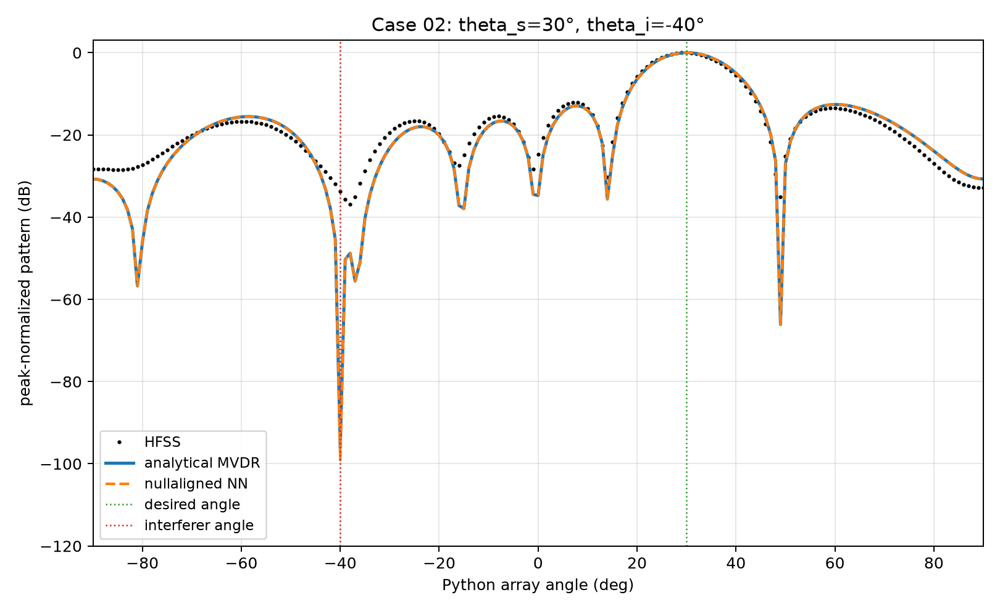<br>**Case 02:** $\theta_s = 30^\circ,\; \theta_i = -40^\circ$ |
| 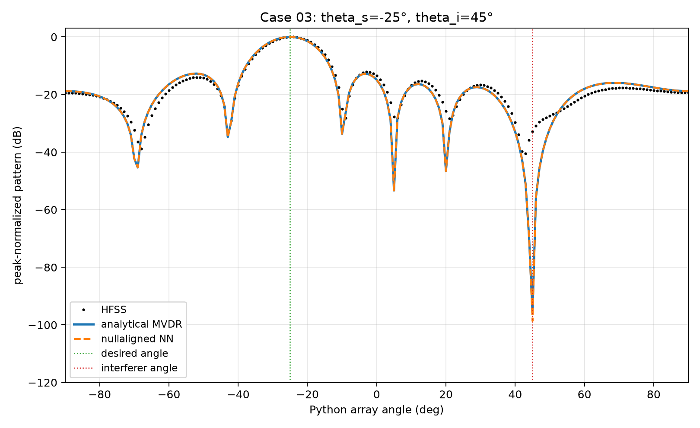<br>**Case 03:** $\theta_s = -25^\circ,\; \theta_i = 45^\circ$ | 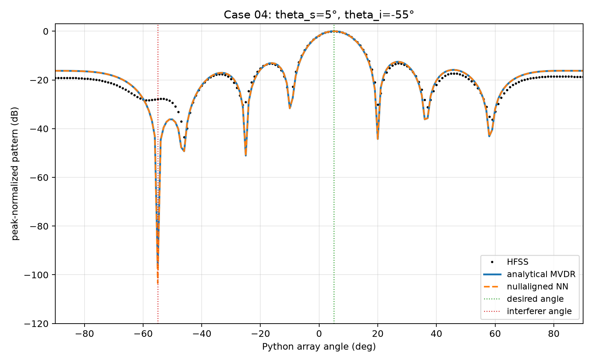<br>**Case 04:** $\theta_s = 5^\circ,\; \theta_i = -55^\circ$ |

<p align="center">
  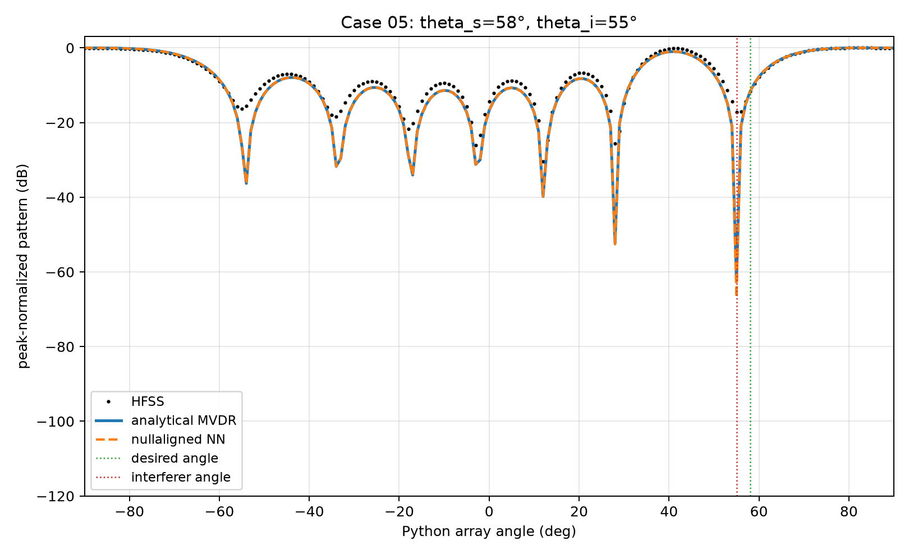<br>
  <strong>Case 05:</strong> 3° near-endfire boundary stress case ($\theta_s = 58^\circ,\; \theta_i = 55^\circ$)
</p>

---

## 6. Repository Structure

| Path | Description |
|:---|:---|
| `physics.py` | Differentiable ULA physics module: float64 $2 \times 2$ Woodbury MVDR solver, PyTorch steering vectors, exact-null basis $\mathbf{u}$, null-aligned synthesis, radial distortionless projection, and physics loss functions. |
| `models.py` | `BeamNet` PyTorch module supporting `raw16`, `subspace`, and `nullaligned` output charts on a shared `[128, 256, 256, 128]` ReLU backbone. |
| `gen_dataset.py` | Deterministic dataset generator producing the 14,042-sample integer-angle grid ($\theta_s, \theta_i \in [-60^\circ, +60^\circ]$, $|\theta_s - \theta_i| \ge 3^\circ$) and fixed 80/10/10 split (`data/dataset_N8.npz`). |
| `train_ablation.py` | Trains and evaluates all six ablation variants (or selected variants via CLI), saving checkpoints, test predictions, and `data/ablation_results.json`. |
| `verify_physics.py` | Standalone numerical proof of Woodbury/Sherman–Morrison equivalence, $\text{span}\{\mathbf{a}_s, \mathbf{a}_i\}$ membership, weight-perturbation sensitivity, and shallow-null SINR loss. |
| `make_plots.py` | Regenerates analytical figures `plots/fig1_sensitivity.png` through `plots/fig6_sinr_cost.png` from saved predictions and metrics. |
| `hfss_build_array.py` | Ansys Electronics Desktop (HFSS 2025 R2, IronPython 2.7) script building the 8-element $y$-directed 2.4 GHz PEC dipole array, `Port1`–`Port8` lumped ports, mesh operations, setup, and `FarField1` sphere. |
| `hfss_overlay.py` | Parses HFSS far-field reports (linear or dB, combined or complex embedded-element mode), evaluates MVDR and `model_nullaligned_full.pth`, and writes `plots/hfss/case_*_overlay.png` + `metrics.csv`. |
| `data/dataset_N8.npz` | Precomputed 14,042-example MVDR dataset (`X_deg`, `Y`, `W`, `AB`, `GT`, `JMIN`, and `idx_train` / `idx_val` / `idx_test`). |
| `data/ablation_results.json` | Exact held-out test-set evaluation metrics for all six ablation variants and analytical baselines. |
| `data/model_*.pth` | Pretrained PyTorch checkpoints for all six ablation variants (`baseline`, `raw16_norm`, `subspace_mse`, `subspace_cost`, `nullaligned_mse`, `nullaligned_full`). |
| `data/pred_*.npz` | Saved held-out test-set weight predictions ($1{,}405 \times 8$ complex) for each variant. |
| `hfss_exports/case_01.csv` … `case_05.csv` | Exported 2.4 GHz Ansys HFSS `GainTotal` far-field tables ($181$ samples each, $\theta \in [-90^\circ, +90^\circ]$ at $\phi = 0^\circ$). |
| `plots/fig1_*.png` … `fig6_*.png` | Analytical sensitivity, ablation, beampattern, CDF, INR-scaling, and SINR-penalty figures. |
| `plots/hfss/case_*_overlay.png`, `metrics.csv` | Full-wave HFSS vs. analytical MVDR vs. PINN overlay plots and quantitative summary CSV. |
| `requirements.txt` | Python dependencies (`numpy>=1.23`, `matplotlib>=3.7`, `torch>=2.0`). |

---

## 7. How to Reproduce

### Environment Setup

```bash
git clone https://github.com/Sreekarji/beamform_nn.git
cd beamform_nn
python -m venv .venv
source .venv/bin/activate        # Windows: .venv\Scripts\activate
python -m pip install -r requirements.txt
```

### Instant Verification & Figure Regeneration (~5 seconds, no retraining)

```bash
# 1. Verify closed-form MVDR identities and perturbation sensitivity
python verify_physics.py

# 2. Regenerate analytical figures (plots/fig1..fig6) from saved predictions
python make_plots.py

# 3. Regenerate HFSS vs. MVDR vs. NN overlays and plots/hfss/metrics.csv
python hfss_overlay.py --input-dir hfss_exports --output-dir plots/hfss
```

### Training (Single Variant or Full Six-Variant Ablation)

```bash
# Optional: regenerate data/dataset_N8.npz (14,042 examples)
python gen_dataset.py

# Quick single-variant training (~5 min on CPU; note: overwrites ablation_results.json with selected variants)
python train_ablation.py nullaligned_mse

# Full 6-variant ablation study (~40 min on CPU; writes all checkpoints + data/ablation_results.json)
python train_ablation.py
```

### Ansys HFSS Physical Array Workflow (Optional — requires Ansys Electronics Desktop)

1. In Ansys Electronics Desktop (2025 R2), click **Tools → Run Script…** and select `hfss_build_array.py`, then run **Analyze All** on `Setup1` (`2.4 GHz`).
2. Under **HFSS → Fields → Edit Sources… → Load From File…**, load 3-column post-processing CSVs (`Source,Magnitude,Phase` for `Port1:1`–`Port8:1` with $P_n = |w_{\text{norm},n}^*|^2\text{W}$ and $\angle w_n^*\text{deg}$).
3. Export `GainTotal` tables over `FarField1` (`Phi = 0°`, `Theta = −90°..+90°`) to `hfss_exports/case_01.csv` … `case_05.csv` and run `python hfss_overlay.py`.

---

## 8. Requirements

| Package | Minimum Version | Purpose |
|:---|:---:|:---|
| Python | 3.9+ | Core runtime |
| NumPy | 1.23+ | Float64 Woodbury MVDR solver and dataset archives |
| PyTorch | 2.0+ | Differentiable array synthesis and CPU model training |
| Matplotlib | 3.7+ | Analytical and HFSS overlay figure generation |
| Ansys HFSS | 2025 R2 *(optional)* | Full-wave 3D FEM dipole array simulation |

---

## 9. References

1. J. Capon, "High-resolution frequency-wavenumber spectrum analysis," *Proceedings of the IEEE*, vol. 57, no. 8, pp. 1408–1418, Aug. 1969.
2. H. L. Van Trees, *Optimum Array Processing (Part IV of Detection, Estimation, and Modulation Theory)*. New York, NY, USA: Wiley, 2002.
3. C. A. Balanis, *Antenna Theory: Analysis and Design*, 4th ed. Hoboken, NJ, USA: Wiley, 2016.
4. G. H. Golub and C. F. Van Loan, *Matrix Computations*, 4th ed. Baltimore, MD, USA: Johns Hopkins University Press, 2013.
5. C. Trabelsi et al., "Deep complex networks," in *Proc. Int. Conf. Learning Representations (ICLR)*, 2018, arXiv:1705.09792.
6. M. Raissi, P. Perdikaris, and G. E. Karniadakis, "Physics-informed neural networks: A deep learning framework for solving forward and inverse problems involving nonlinear partial differential equations," *Journal of Computational Physics*, vol. 378, pp. 686–707, 2019.
7. Ansys, Inc., *Ansys HFSS Help: Radiation, Infinite Spheres, and Post-Processing Source Excitations*, Ansys Electronics Desktop Documentation, 2025.
